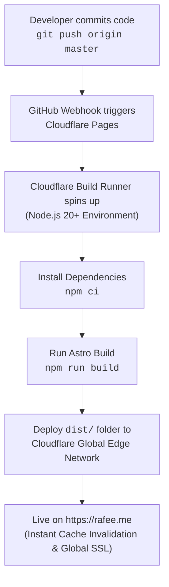

# rafee.me — Personal Portfolio & Technical Blog

Welcome to the source repository for **[rafee.me](https://rafee.me)**, the personal website and technical blog of **Mohammad Ishfaque Jahan Rafee** (Security Engineer).

The site is built with **[Astro](https://astro.build/)** (v5) — leveraging zero-JS by default, strict content collections, Vite-powered builds, Shiki syntax highlighting, and responsive client-rendered Mermaid diagrams. It is continuously deployed to the global edge network via **[Cloudflare Pages](https://pages.cloudflare.com/)**.

---

## Architecture & Technology Stack

| Component | Technology | Description |
| :--- | :--- | :--- |
| **Framework / SSG** | [Astro](https://astro.build/) (`v5`) | Island architecture with static HTML generation, zero client runtime by default. |
| **Content Engine** | Astro Content Collections (`glob` loader) | Strictly typed Markdown/MDX collections with Zod schema validation. |
| **Styling & Theme** | Modern CSS Variables | Dark / Light theme system with instant anti-FOUC script and OS preference detection. |
| **Diagrams** | Mermaid.js & SVG Components | Interactive system architecture diagrams for projects like **Unhurried**. |
| **Search** | Client-Side Instant Search | Lightweight, dependency-free client search across titles, descriptions, and tags. |
| **Feeds & SEO** | `@astrojs/rss` + `@astrojs/sitemap` | Auto-generated RSS 2.0 feed (`/rss.xml`) and XML sitemap (`/sitemap-index.xml`). |
| **Hosting & CDN** | Cloudflare Pages | Automated CI/CD pipeline, edge compute, and global asset distribution. |
| **DNS & Security** | Cloudflare DNS & Edge | Automated SSL/TLS certificates, HTTP/3, DDoS mitigation, and edge caching. |

---

## Deployment Pipeline (Cloudflare Pages)

The website uses Cloudflare Pages' native Git integration. Every push to the `master` branch triggers an automated build and global edge deployment.



### Cloudflare Pages Dashboard Settings

In the **Cloudflare Dashboard** (**Workers & Pages** $\rightarrow$ your project `rafee-me` $\rightarrow$ **Settings**):

#### 1. Build & Deployment Settings
- **Framework Preset**: `Astro` (or `None`)
- **Build Command**: `npm run build` *(or `bash build.sh`)*
- **Build Output Directory**: `dist`
- **Root Directory**: `/`

#### 2. Environment Variables (Production & Preview)
Under **Settings** $\rightarrow$ **Environment variables**:
- `NODE_VERSION`: `22` (or `20`)
- `ASTRO_TELEMETRY_DISABLED`: `1`

> [!NOTE]
> Unlike previous Hugo setups, Astro has **no Git submodule requirements** (`themes/` is eliminated). All styling, components, and layouts reside directly within `src/`.

---

## Directory Structure

```text
rafee.me/
├── public/                 # Static public assets (copied directly to dist/)
│   ├── images/             # Post screenshots, photos, diagrams, and avatar (me.jpg)
│   ├── favicon.svg         # SVG site favicon
│   └── robots.txt          # Search engine crawl directives
├── src/
│   ├── components/         # Reusable Astro components
│   │   ├── Header.astro    # Navigation bar and theme switcher
│   │   ├── Footer.astro    # Footer with copyright and social links
│   │   ├── PostCard.astro  # Blog post preview card
│   │   ├── SocialIcons.astro # GitHub, X/Twitter, LinkedIn, Email, RSS icons
│   │   └── UnhurriedArchitecture.astro # Interactive SVG system architecture diagram
│   ├── content/
│   │   └── posts/          # Markdown blog posts and security write-ups
│   │       ├── HTB_Recollection.md
│   │       ├── HTB_RogueOne.md
│   │       ├── amplify_nuxt.md
│   │       ├── apple_russia_0_day.md
│   │       ├── iac.md
│   │       ├── programming.md
│   │       └── zoning_bylaw.md
│   ├── layouts/
│   │   └── BaseLayout.astro # Base HTML shell, metadata, theme script & Mermaid runner
│   ├── pages/              # File-based routing
│   │   ├── index.astro     # Homepage profile, Unhurried spotlight, recent articles
│   │   ├── about.astro     # About Me: bio, career milestones, certifications
│   │   ├── projects.astro  # Highlights: Unhurried, cloud security, forensics
│   │   ├── archives.astro  # Chronological post timeline
│   │   ├── search.astro    # Instant search interface
│   │   ├── 404.astro       # Custom 404 error page
│   │   ├── rss.xml.ts      # Dynamic RSS feed generator
│   │   ├── posts/          # Blog post list and dynamic [...slug].astro post route
│   │   └── tags/           # Tag directory and dynamic [tag].astro filtered views
│   ├── styles/
│   │   └── global.css      # Core design system, CSS variables, typography, dark/light theme
│   ├── utils/              # Helper utilities
│   │   ├── posts.ts        # Reading time calculation, sorting, and tag extraction
│   │   └── remarkMermaid.mjs # Remark AST processor for Mermaid code fences
│   ├── consts.ts           # Site-wide constants, social links, and author info
│   └── content.config.ts   # Astro v5 Content Collection schema (Zod)
├── astro.config.mjs        # Astro configuration (MDX, Sitemap, Shiki themes)
├── build.sh                # Cloudflare Pages bootstrap script
├── package.json            # Node.js dependencies and build scripts
├── tsconfig.json           # Strict TypeScript configuration
└── README.md               # Project documentation
```

---

## Local Development Workflow

### 1. Prerequisites
- **Node.js** (`>= 18.17.1` or `20+` / `22+`)
- **npm** (`>= 9.0`)

### 2. Installation
Clone the repository and install dependencies:
```bash
git clone https://github.com/rafee/rafee.me.git
cd rafee.me
npm install
```

### 3. Development Server
Start the local development server with hot-module reloading:
```bash
npm run dev
```
Open [http://localhost:4321](http://localhost:4321) in your browser.

### 4. Production Build & Preview
Build the static site into `dist/` and preview it locally:
```bash
npm run build
npm run preview
```

---

## Content Management

### Adding a New Blog Post
Create a Markdown (`.md`) or MDX (`.mdx`) file in `src/content/posts/`:

```markdown
---
title: "Securing Cloud Workloads with Ephemeral Credentials"
description: "A deep dive into IAM role assumption, OIDC federation, and short-lived tokens in multi-cloud environments."
pubDate: 2026-11-03
tags: ["cloud-security", "aws", "iam", "automation"]
draft: false
---

Your markdown content goes here...
```

### Supported Markdown Features
- **Code Highlighting**: Syntax highlighting powered by Shiki (dual light/dark theme).
- **Mermaid Diagrams**: Fenced code blocks with ````mermaid` are automatically rendered into client-side diagrams.
- **Reading Time**: Calculated dynamically at build time.
- **Tags & Taxonomies**: Automatically aggregated under `/tags/` and `/tags/[tag]/`.

---

## Unhurried Project Spotlight

The website features **[Unhurried](https://github.com/Unhurried-Careers)**, an open-source, resilient career navigation and skills-matching platform designed around privacy-preserving microservices, event-driven queues, and containerized cloud workloads.

You can explore the live architecture breakdown and interactive diagram on the [Projects Page](https://rafee.me/projects/) or directly on the homepage.

---

## Author & Social Handles

- **Name**: Mohammad Ishfaque Jahan Rafee
- **Role**: Security Engineer
- **Location**: Edmonton, AB, Canada
- **Website**: [rafee.me](https://rafee.me)
- **GitHub**: [@rafee](https://github.com/rafee)
- **X (Twitter)**: [@rafee_in_sec](https://twitter.com/rafee_in_sec)
- **LinkedIn**: [rafee-sec](https://linkedin.com/in/rafee-sec)
