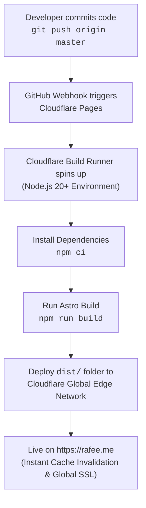

# rafee.me — Personal Portfolio & Technical Blog

Welcome to the source repository for **[rafee.me](https://rafee.me)**, the personal website and technical blog of **Mohammad Ishfaque Jahan Rafee** (Security Engineer).

The site is built with **[Astro](https://astro.build/)** using the **[Astrofy](https://github.com/manuelernestog/astrofy)** theme — styled with **Tailwind CSS** and **daisyUI**, featuring automatic system theme synchronization (**Cupcake** for light mode, **Dark** for dark mode), strict content collections, Shiki syntax highlighting, and responsive client-rendered Mermaid diagrams. It is continuously deployed to the global edge network via **[Cloudflare Pages](https://pages.cloudflare.com/)**.

---

## Architecture & Technology Stack

| Component | Technology | Description |
| :--- | :--- | :--- |
| **Framework / SSG** | [Astro](https://astro.build/) | Island architecture with static HTML generation and zero client runtime by default. |
| **Theme Design** | [Astrofy](https://github.com/manuelernestog/astrofy) | Clean drawer navigation, responsive sidebar, avatar spotlight, and card components. |
| **Styling & UI** | Tailwind CSS + daisyUI | Modern CSS-first theming with automatic system color scheme detection. |
| **Color Schemes** | `cupcake` (Light) & `dark` (Dark) | Soft pastel vanilla aesthetic for light mode; sleek modern theme for dark mode. |
| **Content Engine** | Astro Content Collections (`glob` loader) | Strictly typed Markdown/MDX collections with Zod schema validation. |
| **Diagrams** | Mermaid.js & SVG Components | Interactive system architecture diagrams for projects like **Unhurried**. |
| **Search** | Client-Side Instant Search | Lightweight, dependency-free client search across titles, descriptions, and tags. |
| **Feeds & SEO** | `@astrojs/rss` + `@astrojs/sitemap` | Auto-generated RSS 2.0 feed (`/rss.xml`) and XML sitemap (`/sitemap-index.xml`). |
| **Hosting & CDN** | Cloudflare Pages | Automated CI/CD pipeline, edge compute, and global asset distribution. |
| **DNS & Security** | Cloudflare DNS & Edge | Automated SSL/TLS certificates, HTTP/3, DDoS mitigation, and edge caching. |

---

## Deployment Pipeline (Cloudflare Pages)

The website uses Cloudflare Pages' native Git integration. Every push to the `master` branch triggers an automated build and global edge deployment.



### Cloudflare Pages Dashboard Settings

In the **Cloudflare Dashboard** (**Workers & Pages** $\rightarrow$ your project `rafee-me` $\rightarrow$ **Settings**):

#### 1. Build & Deployment Settings
- **Framework Preset**: `Astro` (or `None`)
- **Build Command**: `npm run build` *(or `bash build.sh`)*
- **Build Output Directory**: `dist`
- **Root Directory**: `/`

#### 2. Environment Variables (Production & Preview)
Under **Settings** $\rightarrow$ **Environment variables**:
- `NODE_VERSION`: `22` (or `20`)
- `ASTRO_TELEMETRY_DISABLED`: `1`

---

## Directory Structure

```text
rafee.me/
├── public/                 # Static public assets (copied directly to dist/)
│   ├── images/             # Post screenshots, photos, diagrams, and avatar (me.jpg)
│   ├── favicon.svg         # SVG site favicon
│   └── robots.txt          # Search engine crawl directives
├── src/
│   ├── components/         # Astrofy UI components
│   │   ├── Header.astro    # Sticky header with mobile drawer toggle & theme button
│   │   ├── SideBar.astro   # Drawer sidebar with avatar, profile, and navigation
│   │   ├── SideBarMenu.astro # Sidebar active item link routing
│   │   ├── SideBarFooter.astro # Social links & quick theme switcher
│   │   ├── HorizontalCard.astro # Signature Astrofy horizontal post/project card
│   │   ├── Footer.astro    # Site footer with theme attribution
│   │   └── UnhurriedArchitecture.astro # Interactive SVG system architecture diagram
│   ├── content/
│   │   └── posts/          # Markdown blog posts and security write-ups
│   │       ├── HTB_Recollection.md
│   │       ├── HTB_RogueOne.md
│   │       ├── amplify_nuxt.md
│   │       ├── apple_russia_0_day.md
│   │       ├── iac.md
│   │       ├── programming.md
│   │       └── zoning_bylaw.md
│   ├── layouts/
│   │   └── BaseLayout.astro # Base drawer shell, metadata, theme anti-FOUC & Mermaid runner
│   ├── pages/              # File-based routing
│   │   ├── index.astro     # Homepage profile, Unhurried spotlight, recent articles
│   │   ├── about.astro     # About & CV: bio, timeline, education, competencies
│   │   ├── projects.astro  # Highlights: Unhurried, cloud security, forensics
│   │   ├── archives.astro  # Chronological post timeline
│   │   ├── search.astro    # Instant search interface
│   │   ├── 404.astro       # Custom 404 error page
│   │   ├── rss.xml.ts      # Dynamic RSS feed generator
│   │   ├── posts/          # Blog post list and dynamic [...slug].astro post route
│   │   └── tags/           # Tag directory and dynamic [tag].astro filtered views
│   ├── styles/
│   │   └── global.css      # Tailwind v4, daisyUI 5 plugin, cupcake/dark themes
│   ├── utils/              # Helper utilities
│   │   ├── posts.ts        # Reading time calculation, sorting, and tag extraction
│   │   └── remarkMermaid.mjs # Remark AST processor for Mermaid code fences
│   ├── consts.ts           # Site-wide constants, social links, and author info
│   └── content.config.ts   # Astro v5 Content Collection schema (Zod)
├── astro.config.mjs        # Astro configuration (MDX, Sitemap, Tailwind Vite plugin)
├── build.sh                # Cloudflare Pages bootstrap script
├── package.json            # Node.js dependencies and build scripts
├── tsconfig.json           # Strict TypeScript configuration
└── README.md               # Project documentation
```

---

## Local Development Workflow

### 1. Prerequisites
- **Node.js** (`>= 18.17.1` or `20+` / `22+`)
- **npm** (`>= 9.0`)

### 2. Installation
Clone the repository and install dependencies:
```bash
git clone https://github.com/rafee/rafee.me.git
cd rafee.me
npm install
```

### 3. Development Server
Start the local development server with hot-module reloading:
```bash
npm run dev
```
Open [http://localhost:4321](http://localhost:4321) in your browser.

### 4. Production Build & Preview
Build the static site into `dist/` and preview it locally:
```bash
npm run build
npm run preview
```

---

## Author & Social Handles

- **Name**: Ishfaque Jahan Rafee
- **Role**: Security Engineer & Enterprise Security Architect (CISSP, AWS Certified Solutions Architect Pro)
- **Location**: Vancouver, BC, Canada
- **Email**: [hire@rafee.me](mailto:hire@rafee.me)
- **Phone**: +1 (780) 920-7797
- **Website**: [rafee.me](https://rafee.me)
- **GitHub**: [@rafee](https://github.com/rafee)
- **X (Twitter)**: [@rafee_in_sec](https://twitter.com/rafee_in_sec)
- **LinkedIn**: [rafee-sec](https://linkedin.com/in/rafee-sec)
