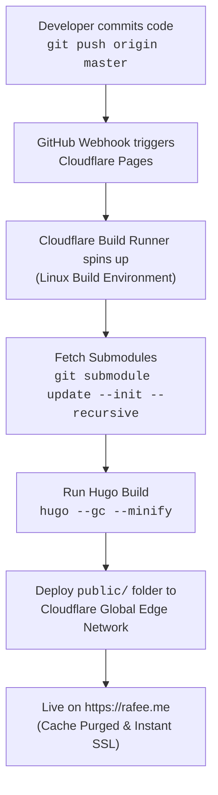

# rafee.me — Personal Portfolio & Technical Blog

Welcome to the source repository for **[rafee.me](https://rafee.me)**, the personal website and technical blog of **Mohammad Ishfaque Jahan Rafee** (Security Engineer).

The site is built as a fast, secure, minimalist static site using **[Hugo](https://gohugo.io/)** and continuously deployed to the global edge network via **[Cloudflare Pages](https://pages.cloudflare.com/)**.

---

## Architecture & Technology Stack

| Component | Technology | Description |
| :--- | :--- | :--- |
| **Static Site Generator (SSG)** | Hugo (`v0.131.0+`) | Generates static HTML/CSS from Markdown in milliseconds. |
| **Theme** | [`PaperMod`](https://github.com/adityatelange/hugo-PaperMod) | Modern, responsive portfolio theme with light/dark mode and Fuse.js search. |
| **Hosting & CDN** | Cloudflare Pages | Automated CI/CD pipeline, edge compute, and global asset distribution. |
| **DNS & Security** | Cloudflare DNS & Edge | Automated SSL/TLS certificates, HTTP/3, DDoS mitigation, and edge caching. |
| **Version Control** | GitHub (`rafee/rafee.me`) | Source code and submodule management. |

---

## How the Deployment Pipeline Works

The website uses Cloudflare Pages' native Git integration. Every push to the `master` branch triggers an automated, containerized build and instant global deployment.



### Pipeline Lifecycle Steps

1. **Trigger**: When you execute `git push origin master`, GitHub issues an authorized webhook event to Cloudflare Pages.
2. **Build Environment**: Cloudflare initializes an isolated container pre-configured with Hugo and Node.js.
3. **Submodule Initialization**: Cloudflare automatically fetches registered Git submodules (`themes/PaperMod`) using `git submodule update --init --recursive`.
4. **Build Execution**: Cloudflare executes the configured build command:
   ```bash
   hugo --gc --minify
   ```
   - `--gc`: Cleans up unused cache items to keep builds lean.
   - `--minify`: Compresses HTML, XML, CSS, and JS files for maximum load speeds.
5. **Asset Distribution**: The generated static output in `public/` is copied across Cloudflare's 300+ edge locations worldwide.
6. **Edge Caching & DNS**: Cloudflare automatically purges cached assets and serves the latest version with zero downtime.

---

## Cloudflare Pages Build Configuration (Build System v3)

In the **Cloudflare Dashboard** (**Workers & Pages** $\rightarrow$ your project $\rightarrow$ **Settings**):

### 1. Build System Version
- Navigate to **Builds & deployments** $\rightarrow$ **Build system version** $\rightarrow$ Select **Version 3** (latest build image).

### 2. Build Settings
- **Framework Preset**: `Hugo`
- **Build Command**: `bash build.sh` *(or `git submodule update --init --recursive && hugo --gc --minify`)*
- **Build Output Directory**: `public`

### 3. Environment Variables (Production & Preview)
Under **Settings** $\rightarrow$ **Environment variables**:
- `HUGO_VERSION`: `0.169.0` *(PaperMod requires a minimum of `0.158.0`)*
- `GIT_SUBMODULE_UPDATE`: `1` (or `true`)

> **Why Previous Builds Fail**:
> 1. **Hugo Version Incompatibility**: PaperMod's latest release strictly requires `min_version = "0.158.0"`. Cloudflare Pages' default Hugo version is older (`0.54.0` on v1 or `0.96.0`/`0.118.0` on v2/v3). Without `HUGO_VERSION >= 0.158.0`, Hugo aborts with `ERROR theme "PaperMod" requires Hugo version 0.158.0 or newer`.
> 2. **Submodule Cloning**: Because themes are Git submodules, if `GIT_SUBMODULE_UPDATE` is omitted, Cloudflare skips downloading `themes/PaperMod`, resulting in `module "PaperMod" not found`.
>
> **The Solution**: We added [`build.sh`](build.sh), an automated self-healing build script that fetches submodules and automatically installs Hugo Extended `v0.169.0` if the container's version is outdated.

---

## Directory Structure

```text
rafee.me/
├── archetypes/           # Hugo content templates (default.md)
├── assets/               # Assets processed by Hugo Pipes (custom CSS/SCSS/JS)
│   └── css/
│       └── custom.css    # Custom design layers (badges, card styling, typography)
├── content/              # Site pages and blog posts (Markdown)
│   ├── about.md          # About Me page (bio, career, publications, competencies)
│   ├── projects.md       # Projects & Highlights page
│   └── posts/            # Technical write-ups and blog articles
│       ├── HTB_Recollection.md
│       ├── HTB_RogueOne.md
│       ├── apple_russia_0_day.md
│       ├── amplify_nuxt.md
│       ├── iac.md
│       └── programming.md
├── static/               # Static assets copied directly to build output without processing
│   └── images/           # Photos, post screenshots, diagrams, and avatar (me.jpg)
├── themes/               # Registered Hugo themes (as Git submodules)
│   └── PaperMod/         # Theme source repository (Git submodule)
├── .devcontainer/        # VS Code Dev Container definitions
├── config.toml           # Core Hugo site configuration, parameters, and navigation
├── netlify.toml          # Legacy Netlify build configuration (reference)
└── README.md             # Project & architecture documentation
```

---

## Local Development Workflow

### 1. Prerequisites
- **Git** (`>= 2.30`)
- **Hugo Extended** (`>= 0.130.0`): Install via Chocolatey (`choco install hugo-extended -confirm`) or Winget (`winget install Hugo.Hugo.Extended`).

### 2. Clone Repository (With Submodules)
Because themes are stored as submodules, clone with `--recursive`:
```bash
git clone --recursive https://github.com/rafee/rafee.me.git
cd rafee.me
```

If already cloned without submodules:
```bash
git submodule update --init --recursive
```

### 3. Start Local Development Server
```bash
hugo server -D
```
- `-D` builds posts marked with `draft: true`.
- Access the site locally at `http://localhost:1313/`.
- Hugo provides instant hot-reloading upon saving any Markdown or configuration file.

---

## Publishing Content

### Adding a New Blog Post
Create a new file in `content/posts/`:
```bash
hugo new posts/your-post-title.md
```
Or manually create `content/posts/your-post-title.md` with standard frontmatter:
```yaml
---
title: "Your Post Title"
description: "A short, engaging description for previews and SEO"
date: 2026-11-03T10:00:00-06:00
tags: ['cloud-security', 'aws', 'dfir', 'python']
draft: false
---

Write your content in Markdown here...
```

### Deploying Changes
Simply push to `master`:
```bash
git add .
git commit -m "Add new post: Your Post Title"
git push origin master
```
Cloudflare Pages automatically detects the commit and deploys the update.

---

## Portfolio Themes & Modernization Guide

The site currently runs **[`PaperMod`](https://github.com/adityatelange/hugo-PaperMod)** with profile mode and custom design enhancements in `assets/css/extended/custom.css`. 

### Recommended Themes for Security & Tech Portfolios

If you would like to explore alternative themes in the future, these are the best-in-class options for technical portfolios:

| Theme | Best For | Standout Features |
| :--- | :--- | :--- |
| **[`hugo-coder`](https://github.com/luizdepra/hugo-coder)** *(Current)* | Minimalist, distraction-free, terminal-inspired | Ultra-fast load times, low complexity, clean typography, dark/light toggle. |
| **[`PaperMod`](https://github.com/adityatelange/hugo-PaperMod)** | Modern tech blogs & portfolios | Profile mode with interactive action buttons, built-in Fuse.js search, cover images, reading time, code copy buttons. |
| **[`Congo`](https://github.com/jpanther/congo)** | Visually rich showcases | Tailwind CSS architecture, modular card grids, article hero images, multi-author support. |
| **[`Terminal`](https://github.com/panr/hugo-theme-terminal)** | Cyber/Hacker aesthetic | Monospaced fonts, retro green/amber accents, CTF feel. |

---

## Maintenance & Incident Rollback

If a bad commit ever causes a build error on Cloudflare Pages:
1. Log in to **Cloudflare Dashboard** $\rightarrow$ **Workers & Pages** $\rightarrow$ **rafee-me** $\rightarrow$ **Deployments**.
2. Locate the last successful build.
3. Click the three dots `...` next to that build and select **Rollback to this deployment**.
4. The edge CDN instantly reverts traffic to the known-good version while you fix the issue locally.
