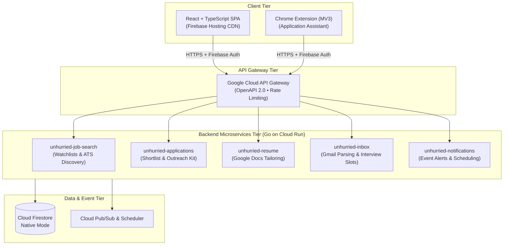

Here is a curated overview of my projects, active software engineering undertakings, security research, and technical experiments.

---

### Featured Project: Unhurried

> **Organization**: [github.com/Unhurried-Careers](https://github.com/Unhurried-Careers)  
> **Live Site / Architecture**: Multi-repository, Cloud-Native Distributed System on Google Cloud  
> **Tech Stack**: Go, React, TypeScript, Google Cloud Run, API Gateway, Firestore, Pub/Sub, Terraform, Firebase Auth & Hosting, Chrome MV3

#### Motivation & Philosophy
AI auto-apply bots have flooded recruitment pipelines, creating noise for hiring teams and fatigue for job seekers. **Unhurried** takes the opposite approach: leveraging AI not as a spam cannon, but as a **personal researcher** that enables candidates to pursue a small, curated set of opportunities with genuine intent and tailored fit.

Key design principles include:
- **Company Watchlists**: Track specific companies with documented rationale before roles are broadly published, actively reading Greenhouse, Lever, and Ashby job boards.
- **Strict Shortlist Limit**: Candidates are hard-capped at a maximum of **5 active roles** at any time. Moving a role to the shortlist requires written answers for *"Why this company?"* and *"Why this role?"*.
- **Intentional Outreach Kit**: Generates personalized 300-character notes aimed at curious, peer-to-peer conversations rather than transactional referral requests.
- **Resume Studio**: Deeply tailors a Google Doc resume to one shortlisted role based on selected skill focus areas.

#### System Architecture & Structure

#### Key Architecture Components

1. **Frontend Tier (`unhurried-web` & `unhurried-extension`)**:
   - Single Page Application built with **React** and **TypeScript**, hosted on **Firebase Hosting** for global low-latency CDN distribution.
   - Dedicated **Chrome Extension (Manifest V3)** that integrates directly with job application portals to pull context and assist intentional submissions.

2. **Backend Microservices (`Go` on Google Cloud Run)**:
   - Five decoupled, single-responsibility services packaged in separate Git repositories:
     - **`unhurried-job-search`**: Polls and monitors external ATS boards (Greenhouse, Lever, Ashby) against user watchlists.
     - **`unhurried-applications`**: Enforces shortlist quotas ($\le 5$), manages the outreach kit, and tracks conversation notes.
     - **`unhurried-resume`**: Tailoring service integrating Google Docs APIs.
     - **`unhurried-inbox`**: Read-only Gmail integration parsing incoming interview invites and proposing calendar slots.
     - **`unhurried-notifications`**: Asynchronous notification dispatch via email.
   - **`unhurried-common`**: Shared Go foundational module standardizing HTTP hardening, token validation, logging, and common data models.

3. **Data & Messaging Tier**:
   - **Cloud Firestore (Native Mode)** provides flexible, low-latency document storage.
   - **Cloud Pub/Sub** and **Cloud Scheduler** orchestrate decoupled background tasks, scheduled ATS scraping, and asynchronous event notifications.

4. **Zero-Trust Security & Identity**:
   - **Dual-Layer Authentication**: Google Identity Platform / Firebase Auth. API Gateway validates incoming JWT ID tokens and API keys; downstream Go services cryptographically re-verify tokens, validate Firebase App Check attestations, and enforce tenant allowlists (`allowed_emails`).

5. **Infrastructure as Code (IaC) & CI/CD (`unhurried-infra`)**:
   - 100% codified using **Terraform** managing all Cloud Run instances, API Gateways, IAM bindings, and Firestore instances.
   - Two-stage pipeline: **GitHub Actions** runs credential-free hermetic CI (linting, tests), while **Google Cloud Build** and **Google Cloud Deploy** handle staging and production rollouts with verified SLSA provenance into Artifact Registry.

6. **Local Developer Experience**:
   - Full offline development workflow: every Go service supports `STORE=memory` and `AUTH_DEV_BYPASS=true`, allowing the entire multi-service ecosystem to run locally in memory without active GCP credentials.

---

### Cloud Security & Automation

#### **Enterprise Multi-Cloud Security Auditing & Guardrails**
- **Focus**: AWS & Oracle Cloud Infrastructure (OCI)
- **Tech Stack**: Python, Go, Bash, AWS SDK (Boto3), OCI SDK, Terraform
- **Description**: Developed custom audit and verification scripts to enforce Cloud Security Posture Management (CSPM) and least-privilege Identity and Access Management (IAM) across hybrid enterprise cloud tenants. Automated the extraction and parsing of security configuration baselines, generating actionable reporting for engineering teams.

#### **Infrastructure as Code (IaC) with Terraform**
- **Focus**: Reproducible Cloud Environments & Disaster Recovery
- **Tech Stack**: Terraform, OCI, AWS, GitOps
- **Description**: Designed modular Terraform configurations to replace error-prone manual console deployments. Ensured disaster recovery environments and cloud workloads can be reliably recreated from declarative, version-controlled definitions with integrated security baselines.

---

### Digital Forensics & Incident Response (DFIR)

#### **Memory Forensics & Malware Analysis (Hack The Box Sherlocks)**
- **Focus**: Threat Hunting & Artifact Extraction
- **Tech Stack**: Volatility 2, Volatility 3, YARA, Wireshark, Linux/CLI tools
- **Highlights**:
  - **Sherlock - Meerkat**: Deep investigation into network attack vectors, Suricata/Snort alert interpretation, and exploit payload tracing.
  - **Sherlock - Recollection & RogueOne**: Full memory dump analysis, locating injected DLLs, anomalous process hierarchies, dumped credentials, and command-and-control (C2) persistence mechanisms.

#### **Threat Intelligence & Telemetry Analysis**
- **Focus**: Zero-Day Vulnerability Research & Defense Hygiene
- **Highlights**: Published technical analyses on sophisticated zero-day, zero-click exploit chains (such as the 2023–2024 Apple iMessage hardware/software vulnerability chain documented by Kaspersky). Emphasized the defensive value of deep SIEM flow-log inspection over superficial perimeter protection.

---

### Academic & Applied Robotics Research

#### **Autonomous Mobile Robot Localization via Monocular Vision**
- **Published**: IEEE Conference Proceedings
- **Tech Stack**: Computer Vision, C++, OpenCV, Projective Geometry, MATLAB
- **Summary**: Implemented a real-time self-localization framework for autonomous mobile robots using monocular camera input tracking planar chessboard pattern markers. Derived exact position and orientation transforms using geometric perspective-n-point algorithms.

#### **Microcontroller-Based Digital Power Factor Correction Converter**
- **Published**: IEEE Conference Proceedings
- **Tech Stack**: Microcontroller Firmware, Power Electronics, MATLAB/Simulink
- **Summary**: Modeled and simulated a closed-loop digital control converter to optimize electrical efficiency and power quality, minimizing harmonic distortion in power distribution systems.

---

### Open Source, Utilities & Problem Solving

#### **Automated Activity & Health Loggers (`StepCounter`, `put_steps`)**
- **GitHub**: [github.com/rafee](https://github.com/rafee)
- **Tech Stack**: Python, APIs, Cloud Storage
- **Summary**: Lightweight CLI utilities designed to automate personal fitness tracking data ingestion, synchronization with cloud storage, and automated log visualization.

#### **Algorithmic Problem Solving (LeetCode)**
- **Focus**: Data Structures & Algorithms
- **Highlights**: Solved over 300 problems across graph theory, dynamic programming, tree traversals, and system design using **Go**, **Python**, **Java**, and **C++**.
